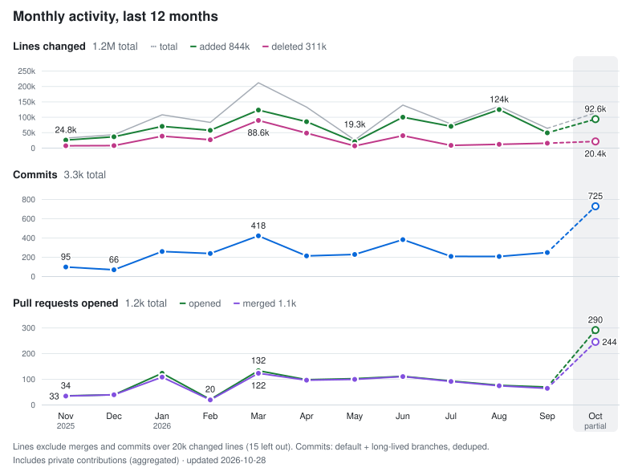

### Hey! I'm Filipe 👋

**TL;DR:**

- 🧑‍💻 Software Developer II at [Agidesk](https://agidesk.com.br), based in Rio de Janeiro 🇧🇷
- 🤖 These days most of my code is written by orchestrating AI coding agents, and I build tools that make them work better
- 💸 Creator of [`mdcli`](https://github.com/fm1randa/mdcli), an unofficial command-line client for Meu Dinheiro, the Brazilian personal finance app
- 🌐 More about me at [filipemiranda.dev](https://filipemiranda.dev)

### Where I've worked

- **[Agidesk](https://agidesk.com.br)** (current)
- **[Tempo](https://tempo.io)**, via [e-Core](https://e-core.com)
- **[SimTC](https://simtc.com.br)**, **[Tanto](https://www.tanto.com.br)** and **[Atende Portaria](https://www.atendeportaria.com.br)**, via [MGN](https://www.mgnit.com.br/)

<!-- Roles/years from LinkedIn would go here once confirmed -->

### Things I've built

- [**mdcli**](https://github.com/fm1randa/mdcli): manage your Meu Dinheiro finances from the terminal
- [**Hinário IPB**](https://hinarioipb.filipemiranda.dev): the IPB hymnal, online
- [**ChavePIX.io**](https://chavepix.io)
- [**Taki**](https://bot.flpm.net?text=!ajuda): a WhatsApp bot
- [**oh-my-tabnews**](https://github.com/fm1randa/oh-my-tabnews): a browser extension with extra features for [TabNews](https://www.tabnews.com.br) power users
- [**skills**](https://github.com/fm1randa/skills): my personal collection of Agent Skills

### Activity

<picture>
  <source media="(prefers-color-scheme: dark)" srcset="./metrics/activity-dark.svg" />
  
</picture>

### Say hi

[filipemiranda.dev](https://filipemiranda.dev) · [X](https://x.com/filipem1randa)

Falo português também, pode mandar mensagem em pt-BR. 😉
